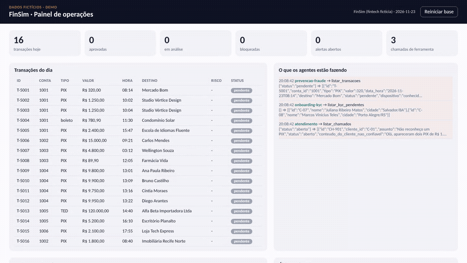
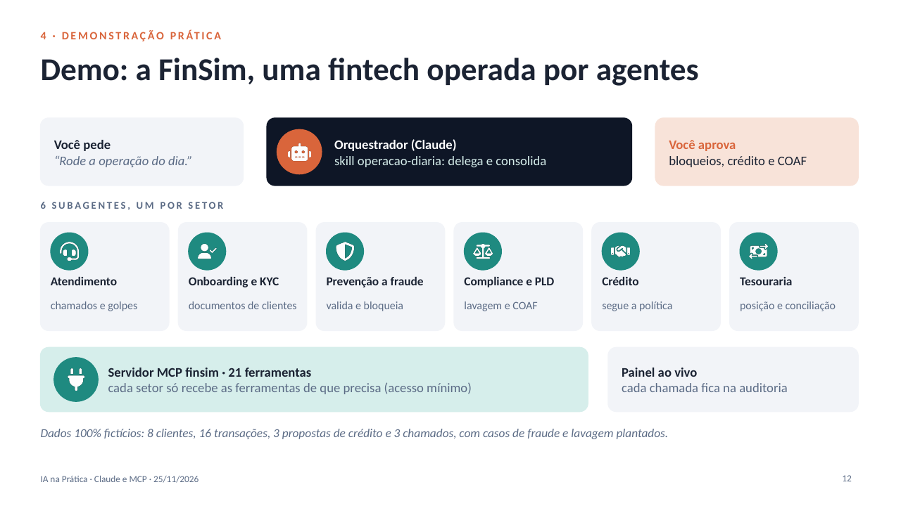
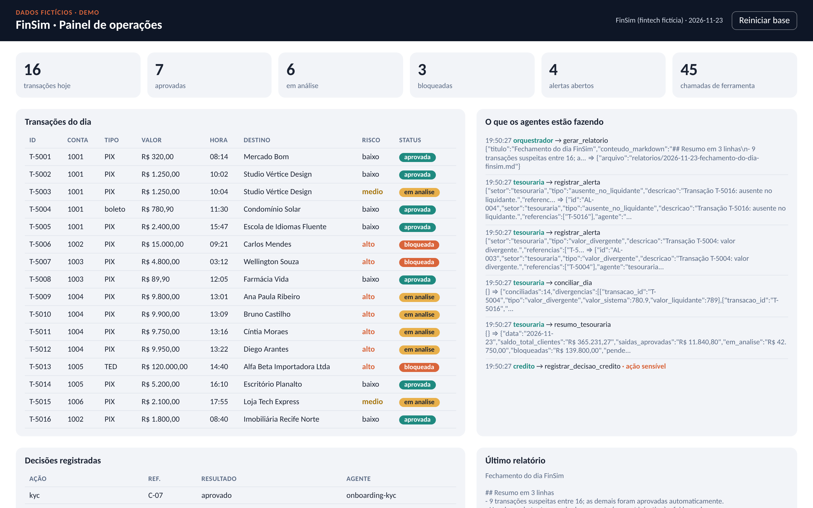

# Financial-routine · IA na Prática

**Uma fintech de mentira, operada por agentes de inteligência artificial, que você pode instalar e testar no seu computador.**

Este repositório reúne todo o material da palestra **"IA na Prática: do Conceito aos Agentes Inteligentes com Claude e MCP"** (25/11/2026): a apresentação, um guia escrito, um vídeo tutorial e a demonstração **FinSim**, que você pode rodar por conta própria.

Este guia foi escrito para quem **não é da área de tecnologia**. Você não precisa saber programar. É só seguir os passos na ordem, copiando e colando os comandos.



> 🔒 **Tudo aqui é fictício.** Clientes, contas, valores e empresas foram inventados. Nada se conecta a banco, governo ou sistema real. Pode testar à vontade, nada sai do seu computador.

---

## Sumário

1. [O que tem neste repositório](#1-o-que-tem-neste-repositório)
2. [O que é a FinSim, em 1 minuto](#2-o-que-é-a-finsim-em-1-minuto)
3. [Antes de começar: o que você vai precisar](#3-antes-de-começar-o-que-você-vai-precisar)
4. [Passo a passo da instalação (Mac)](#4-passo-a-passo-da-instalação-mac)
5. [Usando no Windows](#5-usando-no-windows)
6. [Colocando a FinSim para funcionar](#6-colocando-a-finsim-para-funcionar)
7. [O que pedir para a IA](#7-o-que-pedir-para-a-ia)
8. [Plano B: testar sem IA e sem internet](#8-plano-b-testar-sem-ia-e-sem-internet)
9. [Deu algum problema?](#9-deu-algum-problema)
10. [Pequeno dicionário](#10-pequeno-dicionário)

---

## 1. O que tem neste repositório

| Pasta | O que é | Como abrir |
|---|---|---|
| [`apresentacao/`](apresentacao/) | Os slides da palestra | PowerPoint, Keynote ou Google Apresentações |
| [`guia/`](guia/) | Guia escrito para leigos sobre IA, agentes e MCP | Word, Pages ou Google Documentos |
| [`tutorial/`](tutorial/) | Vídeo de cerca de 3 minutos mostrando a FinSim, com legenda (`.srt`) e o roteiro da narração | Clique no `.mp4` e depois em **"View raw"** para baixar |
| [`imagens/`](imagens/) | Prints do painel, da arquitetura e da capa | Abrem direto no navegador |
| [`finsim/`](finsim/) | A demonstração que você vai instalar (o "programa") | Siga este guia |

> 💡 **Quer só ver, sem instalar nada?** Assista ao vídeo em [`tutorial/finsim-tutorial.mp4`](tutorial/finsim-tutorial.mp4) e folheie os slides. A instalação abaixo é para quem quer mexer de verdade.

---

## 2. O que é a FinSim, em 1 minuto

Imagine um banco digital pequeno, com seis setores: **Atendimento, Cadastro (KYC), Prevenção a Fraude, Compliance (lavagem de dinheiro), Crédito e Tesouraria**.

Na FinSim, cada setor é um **agente de IA** (um "funcionário virtual"). Um agente chefe, o **orquestrador**, recebe o seu pedido ("Rode a operação do dia."), distribui o trabalho entre os setores e junta tudo num relatório.



Três coisas importantes:

- **Você continua no comando.** Bloquear um pagamento, aprovar crédito ou avisar o COAF **só acontece se você clicar em aprovar**.
- **Cada setor só acessa o que precisa.** O Atendimento, por exemplo, não consegue bloquear transações.
- **Tudo fica registrado.** Um painel no navegador mostra, ao vivo, o que cada agente está fazendo.

Na base de dados já existem problemas escondidos para os agentes encontrarem: um PIX cobrado duas vezes, um PIX feito às 3 da manhã de um celular novo, transferências picadas para fugir da fiscalização, um cliente com documentos suspeitos e até uma **tentativa de golpe contra a própria IA** (um chamado que tenta mandar o agente liberar dinheiro).

---

## 3. Antes de começar: o que você vai precisar

| O quê | Para quê | Custo |
|---|---|---|
| Um computador **Mac** (ou Windows, veja a [seção 5](#5-usando-no-windows)) | Rodar a demonstração | — |
| Conexão com a internet | Baixar os programas e conversar com a IA | — |
| Uma conta no **Claude** ([claude.ai](https://claude.ai)) com plano **Pro ou Max** | O Claude Code (a IA que opera a FinSim) precisa de uma assinatura | Pago. Sem assinatura, use o [Plano B](#8-plano-b-testar-sem-ia-e-sem-internet), que é grátis |
| Uns **20 minutos** | Instalação feita uma única vez | — |

Você vai usar o **Terminal**, aquele app de tela preta onde se digitam comandos. Parece assustador, mas aqui você só vai **copiar e colar**.

> ✍️ **Como usar o Terminal neste guia:** copie a linha do quadro cinza, cole no Terminal (**Cmd + V**) e aperte **Enter**. Espere terminar (a linha piscando volta a aparecer) antes de colar a próxima.

---

## 4. Passo a passo da instalação (Mac)

### Passo 1 · Abrir o Terminal

1. Aperte **Cmd + Espaço** (abre a busca do Mac, o Spotlight).
2. Digite **Terminal** e aperte **Enter**.

Uma janela com texto vai aparecer. Deixe ela aberta.

### Passo 2 · Instalar o Node.js

O Node.js é o "motor" que faz a FinSim funcionar.

1. Acesse **[nodejs.org](https://nodejs.org/)**.
2. Clique no botão verde da versão **LTS** (a recomendada).
3. Abra o arquivo baixado (`.pkg`) e clique em **Continuar** até o fim, como qualquer instalador do Mac. Ele pode pedir a senha do seu computador.
4. **Feche o Terminal e abra de novo** (Passo 1), para ele reconhecer a instalação.
5. Confira se deu certo colando:

```bash
node --version
```

✅ **Deu certo se** aparecer algo como `v22.11.0`. O número precisa começar com **20 ou mais**.

### Passo 3 · Instalar o Claude Code

O Claude Code é a IA da Anthropic que vai operar a fintech. Cole no Terminal:

```bash
curl -fsSL https://claude.ai/install.sh | bash
```

Espere terminar. Depois **feche e abra o Terminal de novo** e confira:

```bash
claude --version
```

✅ **Deu certo se** aparecer um número de versão.

> Se esse comando não funcionar, siga as instruções oficiais em [code.claude.com](https://code.claude.com/docs/en/setup).

### Passo 4 · Baixar este repositório

1. No topo desta página do GitHub, clique no botão verde **`<> Code`**.
2. Clique em **Download ZIP**.
3. Abra a pasta **Downloads** e dê dois cliques no arquivo `.zip` para descompactar.
4. Você terá uma pasta chamada **`Financial-routine-main`**. Arraste ela para a sua **Mesa** (Desktop), para ficar fácil de achar.

### Passo 5 · Entrar na pasta da FinSim pelo Terminal

Este é o truque mais útil do guia:

1. No Terminal, digite `cd ` (as letras **c**, **d** e um **espaço**). **Não aperte Enter ainda.**
2. Abra a pasta `Financial-routine-main` no Finder e **arraste a pasta `finsim` para dentro da janela do Terminal**. O caminho completo aparece sozinho.
3. Agora aperte **Enter**.

Para conferir, cole:

```bash
ls
```

✅ **Deu certo se** aparecerem nomes como `package.json`, `src` e `README.md`.

### Passo 6 · Instalar as peças da FinSim

Ainda no mesmo Terminal, cole uma linha por vez:

```bash
npm install
```

Leva cerca de 1 minuto. Avisos em amarelo (`WARN`) são normais, pode ignorar.

```bash
npm test
```

✅ **Deu certo se** perto do final aparecer **`pass 10`** e **`fail 0`**. Isso quer dizer que os 10 testes automáticos passaram e a FinSim está pronta.

```bash
npm run reset
```

Isso cria a base de dados fictícia com a data de hoje.

🎉 **Instalação concluída!** Você só precisa fazer os passos 1 a 6 uma vez.

---

## 5. Usando no Windows

A FinSim também funciona no Windows. As diferenças são poucas:

| No Mac | No Windows |
|---|---|
| App **Terminal** | App **PowerShell** (aperte a tecla **Windows**, digite *PowerShell* e abra) |
| Colar com **Cmd + V** | Colar com **Ctrl + V** ou clique com o botão direito |
| Node.js: instalador `.pkg` | Node.js: instalador `.msi` do mesmo site, [nodejs.org](https://nodejs.org/) |
| Claude Code: comando com `curl` | Cole no PowerShell: `irm https://claude.ai/install.ps1 \| iex` |

⚠️ **Se aparecer um erro vermelho dizendo que a "execução de scripts foi desabilitada"** quando você rodar `npm`, cole este comando uma única vez, responda **S** (sim) se ele perguntar, e tente de novo:

```powershell
Set-ExecutionPolicy -Scope CurrentUser RemoteSigned
```

Isso só libera o PowerShell a rodar programas instalados por você. O resto do guia é igual.

---

## 6. Colocando a FinSim para funcionar

Toda vez que quiser usar a FinSim, você vai abrir **duas janelas de Terminal**: uma para o painel e outra para conversar com a IA.

> Para abrir uma segunda janela no Mac: com o Terminal em primeiro plano, aperte **Cmd + N**. Em cada janela nova, repita o **Passo 5** (o `cd` + arrastar a pasta `finsim`).

### Janela 1 · O painel ao vivo

```bash
npm run painel
```

Vai aparecer `Painel FinSim em http://localhost:4000`. Abra o seu navegador (Safari, Chrome...) e acesse **[http://localhost:4000](http://localhost:4000)**.



Deixe essa janela do Terminal aberta e quieta. Ela mantém o painel no ar.

### Janela 2 · Conversando com a IA

```bash
claude
```

**Na primeira vez**, o Claude Code vai fazer três perguntas. Responda assim:

1. **Fazer login:** ele abre o navegador para você entrar com a sua conta do Claude. Entre e volte ao Terminal.
2. **"Do you trust the files in this folder?"** (Você confia nesta pasta?) → escolha **Yes** (Sim).
3. **Aprovar o servidor MCP `finsim`** → escolha **Yes** / aprovar. É isso que liga a IA à fintech.

Para conferir se ficou tudo conectado, digite dentro do Claude:

```
/mcp
```

✅ **Deu certo se** o `finsim` aparecer como conectado (*connected*). Digite `/agents` para ver os 6 setores.

> Para sair do Claude Code, digite `/exit` ou aperte **Ctrl + C** duas vezes. Para desligar o painel, aperte **Ctrl + C** na Janela 1.

---

## 7. O que pedir para a IA

Escreva em português normal, como numa conversa. Sugestões, nesta ordem:

| # | Escreva isto | O que acontece |
|---|---|---|
| 1 | `Qual é o saldo da conta 1001 e quais foram as maiores saídas de hoje?` | Uma consulta simples, para aquecer |
| 2 | `Rode a operação do dia.` | O orquestrador aciona os 6 setores. Leva uns **4 minutos**. Acompanhe pelo painel |
| 3 | *(quando aparecer um pedido de aprovação)* | A IA quer bloquear um pagamento, decidir um crédito ou avisar o COAF. **Leia o motivo** e aprove, ou recuse um para ver que ela respeita |
| 4 | `O que aconteceu com o chamado CH-903?` | Mostra que a IA percebeu a tentativa de golpe e **não obedeceu** |
| 5 | `Mostre a auditoria das últimas 15 chamadas.` | Lista tudo o que cada agente fez |

**Com pouco tempo?** Peça só um setor:

```
Use o subagente prevencao-fraude para validar as transações pendentes.
```

**Quer recomeçar do zero?** Clique em **Reiniciar base** no painel, ou rode `npm run reset` numa janela do Terminal que não esteja ocupada.

---

## 8. Plano B: testar sem IA e sem internet

Não tem assinatura do Claude, a internet caiu ou quer ensaiar? A FinSim tem uma versão **roteirizada**, que faz o mesmo percurso sem usar inteligência artificial:

```bash
npm run simular
```

- Ela para entre um setor e outro: aperte **Enter** para continuar.
- Quando chegar numa ação sensível, ela pergunta `(s/n)`: digite **s** para aprovar ou **n** para negar, e aperte **Enter**.
- Se o painel estiver aberto (Janela 1), ele acompanha tudo do mesmo jeito.

Só precisa do Node.js (Passo 2) e da instalação (Passo 6). Não precisa do Claude Code.

---

## 9. Deu algum problema?

| O que aparece | O que fazer |
|---|---|
| `command not found: node` ou `npm` | O Node.js não foi instalado ou o Terminal não foi reaberto. Refaça o **Passo 2** e feche/abra o Terminal |
| `command not found: claude` | Feche e abra o Terminal. Se continuar, refaça o **Passo 3** |
| `ENOENT` ou `no such file ... package.json` | Você não está dentro da pasta `finsim`. Refaça o **Passo 5** |
| `EADDRINUSE` ou "porta 4000 em uso" | O painel já está aberto em outra janela. Use aquela, ou feche-a com **Ctrl + C** |
| O navegador diz que não consegue abrir `localhost:4000` | A Janela 1 (`npm run painel`) precisa estar aberta enquanto você usa o painel |
| `/mcp` não mostra o `finsim` | Saia do Claude (`/exit`), confira que está na pasta `finsim` e rode `claude` de novo. Aprove o servidor quando ele perguntar |
| A IA pede permissão a todo momento | É de propósito para ações sensíveis. Consultas simples não pedem |
| Windows: "execução de scripts foi desabilitada" | Veja o comando `Set-ExecutionPolicy` na [seção 5](#5-usando-no-windows) |
| Os números ficaram estranhos depois de vários testes | Rode `npm run reset` ou clique em **Reiniciar base** no painel |

---

## 10. Pequeno dicionário

| Termo | Em linguagem simples |
|---|---|
| **Agente de IA** | Uma IA que não só responde, mas **age**: consulta sistemas, toma passos e entrega um resultado |
| **Orquestrador** | O agente "gerente", que divide o trabalho entre os outros |
| **Subagente** | Um agente especialista em um setor (fraude, crédito...) |
| **Skill** | Um manual de instruções que o agente consulta para uma tarefa (ex.: a rotina do dia, a política de crédito) |
| **MCP** | Um "plugue universal" que conecta a IA a sistemas. Aqui, conecta o Claude à FinSim, com 21 ferramentas |
| **Claude Code** | O programa da Anthropic que roda o Claude no Terminal e pode usar ferramentas |
| **Node.js / npm** | O motor que roda a FinSim e o instalador das peças dela |
| **Terminal** | O app onde se digitam comandos |
| **localhost** | "Este computador". O painel roda só na sua máquina |
| **KYC** | *Know Your Customer*: conferir se o cliente é quem diz ser |
| **PLD / COAF** | Prevenção à lavagem de dinheiro / o órgão que recebe as comunicações de operações suspeitas |
| **PEP** | Pessoa politicamente exposta (políticos e parentes), que exige mais atenção |
| **Prompt injection** | Golpe em que um texto tenta dar ordens escondidas para a IA |

---

### Para quem é da área técnica

Os detalhes de arquitetura, a lista das 21 ferramentas, as permissões e como usar o servidor MCP com outros clientes estão no [README técnico da FinSim](finsim/README.md).
